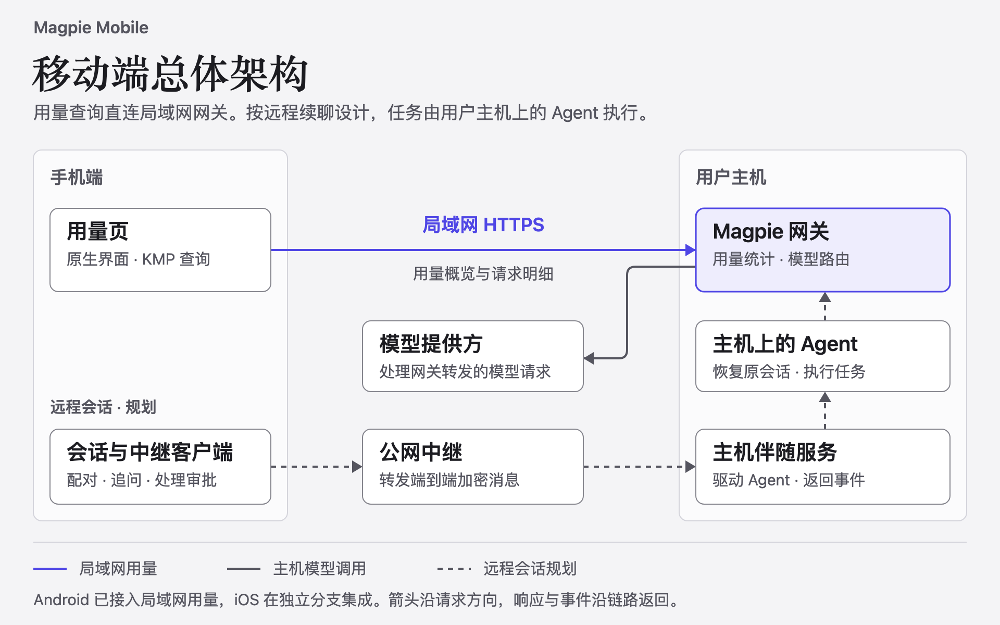

# Magpie Mobile

**English** · [简体中文](README.zh-CN.md)

**Track agent requests, token usage, and costs on your Magpie gateway from your phone.**

Independent, open-source Android and iOS clients for [Magpie](https://github.com/yetone/magpie).

**[Download the Android preview APK](https://github.com/AndyChen1024/magpie-mobile/releases)** · **[Build from source](#build-from-source)** · **[Project documentation](#project-documentation)** · **[Report an issue](https://github.com/AndyChen1024/magpie-mobile/issues)**

## Project status

Magpie Mobile is in early development. On Android 9 or later, download the APK from a GitHub prerelease. To try it without a gateway, open **更多 → 用量 → 查看演示数据** (More → Usage → View demo data). You can build the iOS app from source.

| Platform | Available today |
| --- | --- |
| Android | Built with Kotlin and Jetpack Compose. View read-only usage over the local network, including request counts, tokens, known costs, and individual requests for today, the last 7 days, or the last 30 days. Demo data works offline. |
| iOS | Built with SwiftUI. Integration with the local gateway is in progress on a separate development branch. |

## Build from source

Clone the repository and check out the branch you want to try.

- **Android.** Open `magpie-android/` in Android Studio. Sync with Android SDK 37 and Gradle JDK 25, then run `app` on a device or emulator with Android 9 (API 28) or later.
- **iOS.** On a Mac, open `magpie-ios/magpie-ios.xcodeproj` in Xcode. Select the `magpie-ios` scheme and an iOS 27.2 or later simulator. To run on a physical device, select your own development team for signing.

### View gateway usage on Android

1. Open **更多 → 用量** (More → Usage). Choose **查看演示数据** (View demo data) to explore the screens offline.
2. To see your own usage, enable LAN sharing on the computer running Magpie. You need a gateway key and an HTTPS address reachable from your phone. The app must trust the gateway certificate, and the certificate must match the address you enter. [Magpie LAN sharing guide](https://github.com/yetone/magpie/blob/426a707a19ff7f481989f03c49519bf4dba1e593/docs/integrating.md#L50)
3. Connect your phone and the host to the same local network. Under **用量 → 连接主机** (Usage → Connect to host), enter the address and gateway key. Once connected, select a time range to view totals or browse individual requests.

## Project documentation

The engineering documents and diagrams below are in Simplified Chinese.

| Document | What it covers |
| --- | --- |
| [Read-only usage over the LAN](docs/usage/README.md) | Gateway API, platform responsibilities, and acceptance tests |
| [Kotlin Multiplatform shared module](shared/README.md) | Usage queries, pagination, builds, tests, and Swift integration |
| [Mobile architecture](docs/architecture.md) | System boundaries, native app structure, shared components, and the flow of usage data |
| [Mobile UI design](docs/mobile-ui.md) | Navigation, screen layouts, usage details, and wireframes for remote sessions |
| [Git and release workflow (draft)](docs/git-workflow.md) | Branches, pull requests, platform checks, and releases |
| [Engineering principles (discussion draft)](docs/CONSTITUTION.md) | Shared responsibilities, API permissions, and acceptance criteria |
| [Working agreements for coding agents](AGENTS.md) | Repository conventions, verification, and collaboration |

## Feedback and contributions

Use GitHub Issues to report a problem or discuss a feature. For connection or usage problems, include your phone's OS version, the Magpie version on your host, and steps to reproduce the issue. Remove gateway keys and other sensitive information before posting. [GitHub Issues](https://github.com/AndyChen1024/magpie-mobile/issues)

When submitting a pull request, list the affected platforms and describe what you tested. [PR checks](docs/git-workflow.md#pr-验收与-github-门禁)

## Relay for remote sessions

For the first remote session preview, the project plans to host Paseo Relay on Fly.io. The relay will forward end-to-end encrypted messages between the phone and the user's host, where the agent executes tasks. Local usage queries go directly to the Magpie gateway. [Paseo Relay project](https://github.com/getpaseo/paseo-relay)

## License

Magpie Mobile uses the MIT License. The Gradle Wrapper distributed with the Android project uses Apache-2.0. Its notices are in the launcher scripts and the Wrapper JAR. [MIT License](LICENSE)

Thanks to Magpie and its contributors. The Android app includes the upstream MIT notice for the assets it uses. [Magpie](https://github.com/yetone/magpie) · [Upstream license notice](magpie-android/app/src/main/assets/licenses/magpie.txt)
