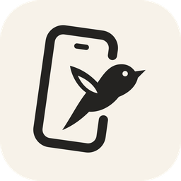
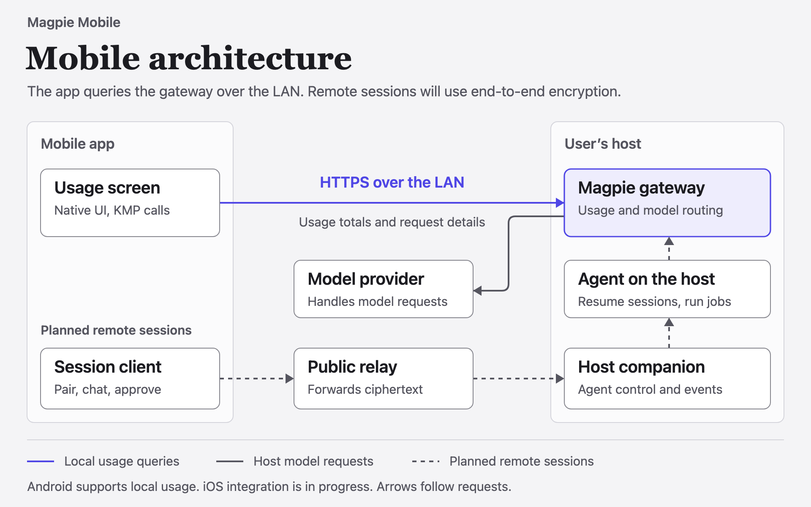

# Magpie Mobile

**English** · [简体中文](README.zh-CN.md)

**Track agent requests, token usage, and costs on your Magpie gateway from your phone.**

Independent, open-source Android and iOS clients for [Magpie](https://github.com/yetone/magpie).

**[Download the Android 0.1.0-alpha.4 APK](https://github.com/AndyChen1024/magpie-mobile/releases)** · **[Build from source](#build-from-source)** · **[Project documentation](#project-documentation)** · **[Report an issue](https://github.com/AndyChen1024/magpie-mobile/issues)**

## Project status

Magpie Mobile is in early development. On Android 9 or later, install the preview APK from GitHub Releases. You can try the offline demo before connecting a gateway. On iOS, build the app from source.

To pair the mobile app with a Mac, open **Plugins → Discover** in Magpie and search for `magpie-connect-phone` or `连接手机`. You can also add `github:AndyChen1024/magpie-connect-phone` directly. [Mac companion plugin](https://github.com/AndyChen1024/magpie-connect-phone)

| Platform | Available today |
| --- | --- |
| Android | Built with Kotlin and Jetpack Compose. View usage trends, agent and model rankings, costs, and request details for today, the last 7 days, or the last 30 days. Connect over HTTPS or use a paired Mac with the companion plugin. Demo data works offline. |
| iOS | Built with SwiftUI. Open **More → Usage** to view the local gateway’s usage summary and individual requests, or try the offline demo. |

## Build from source

Clone the repository and check out the branch you want to try.

- **Android.** Open `magpie-android/` in Android Studio. Sync with Android SDK 37 and Gradle JDK 25, then run `app` on a device or emulator with Android 9 (API 28) or later.
- **iOS.** Follow the [iOS build guide](magpie-ios/README.md#构建) to build the shared framework for live gateway data. Open `magpie-ios/magpie-ios.xcodeproj` in Xcode and run the `magpie-ios` scheme on iOS 16.4 or later. Use iOS 17 or later for XCTest. To run on a physical device, select your own development team for signing.

### View gateway usage on Android

The Android preview supports English and Simplified Chinese.

1. Open **More** at the bottom right and select **Usage**. Choose **View demo data** to explore the screens offline.
2. To see your own usage, enable LAN sharing on the computer running Magpie. You need a gateway key and an HTTPS address reachable from your phone. The app must trust the gateway certificate, and the certificate must match the address you enter. [Magpie LAN sharing guide](https://github.com/yetone/magpie/blob/426a707a19ff7f481989f03c49519bf4dba1e593/docs/integrating.md#L50)
3. Connect your phone and the host to the same local network. On the **Usage** screen, choose **Connect to host** and enter the address and gateway key. If the Mac uses Magpie’s built-in HTTPS, export its `magpie-ca.crt` and choose **Import CA** in the connection form. Once connected, select a time range to view totals or browse individual requests.

## Project documentation

The engineering guides listed below are in Simplified Chinese.

| Document | What it covers |
| --- | --- |
| [Read-only usage over the LAN](docs/usage/README.md) | Gateway API, platform responsibilities, and acceptance tests |
| [Kotlin Multiplatform shared module](shared/README.md) | Usage queries, pagination, builds, tests, and Swift integration |
| [Mobile architecture](docs/architecture.md) | System boundaries, native app structure, shared components, and the flow of usage data |
| [Mobile UI design](docs/mobile-ui.md) | Navigation, screen layouts, usage details, and wireframes for remote sessions |
| [Git and release workflow](docs/git-workflow.md) | Upstream Magpie practices, integration on main, platform checks, and releases |
| [Engineering principles (discussion draft)](docs/CONSTITUTION.md) | Shared responsibilities, API permissions, and acceptance criteria |
| [Working agreements for coding agents](AGENTS.md) | Repository conventions, verification, and collaboration |

## Feedback and contributions

When reporting a connection problem, include the phone OS, the host's Magpie version, the network path (same Wi-Fi, USB forwarding, or cellular), the steps to reproduce it, and the error message. In public screenshots, cover the entire pairing QR code, pairing link, device names, and private network addresses. Keep gateway keys and deployment tokens in their respective credential stores. [GitHub Issues](https://github.com/AndyChen1024/magpie-mobile/issues)

In the commit body, list the affected platforms and describe what you tested. If you open a pull request, identify the commit you verified. [Git and release workflow (Simplified Chinese)](docs/git-workflow.md)

## Relay for remote sessions

On the same LAN, the phone reads usage directly from the Magpie HTTPS gateway without a relay. Development builds can pair through a test relay and read the Mac's name. Scanning a QR code to connect directly to the Mac service over home Wi-Fi is still a design goal. [Mac plugin and local setup](magpie-plugin/README.md)

For remote sessions, the project plans to operate a Paseo Relay. It will forward end-to-end encrypted messages between the phone and the host, where the agent runs. Clients can know the relay address. The Mac checks each device's authorization separately. A complete pairing code contains a one-time authorization ticket, so share it only with the device you intend to pair. [Paseo Relay project](https://github.com/getpaseo/paseo-relay)

## License

Magpie Mobile uses the MIT License. The Gradle Wrapper distributed with the Android project uses Apache-2.0. Its notices are in the launcher scripts and the Wrapper JAR. [MIT License](LICENSE)

Thanks to Magpie and its contributors. The Android app includes the upstream MIT notice for the assets it uses. [Magpie](https://github.com/yetone/magpie) · [Upstream license notice](magpie-android/app/src/main/assets/licenses/magpie.txt)
