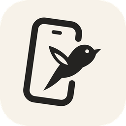
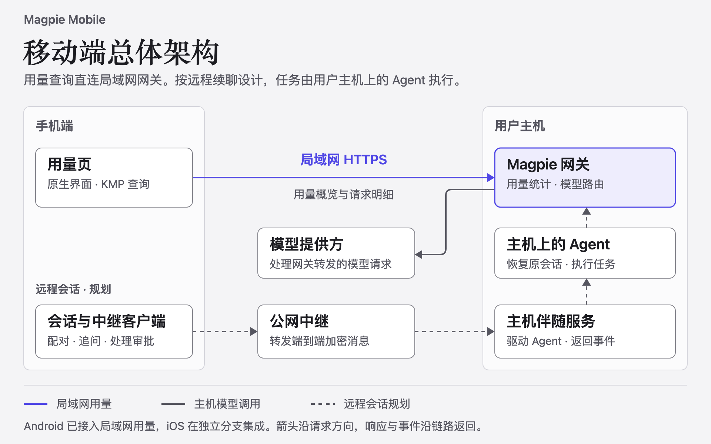

# Magpie Mobile

[English](README.md) · **简体中文**

**在手机上查看 Magpie 网关的 Agent 用量。**

面向 [Magpie](https://github.com/yetone/magpie) 用户的独立 Android 和 iOS 开源客户端。

**[下载 Android 0.1.0-alpha.3 内测 APK](https://github.com/AndyChen1024/magpie-mobile/releases)** · **[从源码运行](#本地开发)** · **[工程文档](#工程文档)** · **[问题反馈](https://github.com/AndyChen1024/magpie-mobile/issues)**

## 当前进度

项目处于早期开发阶段。Android 9 或更新版本可在 GitHub Releases 的预发布条目中下载 APK，安装后打开 **更多 → 用量 → 查看演示数据** 即可体验。iOS 可从源码运行。

| 平台 | 当前实现 |
| --- | --- |
| Android | 使用 Kotlin 和 Jetpack Compose。已接入局域网只读用量，可按今天、最近 7 天和最近 30 天查看调用次数、token、已知费用及请求明细。也可离线查看演示数据。 |
| iOS | 使用 SwiftUI。在「更多 → 用量」可查看局域网网关的用量概览和请求明细，也可离线查看演示数据。 |

## 本地开发

克隆仓库并检出要体验的分支，然后按平台运行。

- **Android**。在 Android Studio 打开 `magpie-android/`，使用 Android SDK 37 和 Gradle JDK 25 同步项目，然后在 Android 9（API 28）或更新的设备或模拟器上运行 `app`。
- **iOS**。按 [iOS 构建说明](magpie-ios/README.md#构建)生成读取真实网关数据所需的共享框架。在 Mac 上用 Xcode 打开 `magpie-ios/magpie-ios.xcodeproj`，选择 `magpie-ios` Scheme。应用支持 iOS 16.4 及以上，运行 XCTest 需要 iOS 17 及以上。真机调试时请选择自己的开发团队。

### 在 Android 上查看用量

1. 打开 **更多 → 用量**，选择 **查看演示数据**，即可预览页面。
2. 要查看自己的数据，在运行 Magpie 的电脑上开启局域网共享，准备手机可访问的 HTTPS 网关地址和网关密钥。网关证书须受应用信任，并匹配访问地址。[Magpie 局域网共享说明](https://github.com/yetone/magpie/blob/426a707a19ff7f481989f03c49519bf4dba1e593/docs/integrating.md#L50)
3. 让手机和主机接入同一局域网，在 **用量 → 连接主机** 填写地址和密钥。如果 Mac 使用 Magpie 内置的 HTTPS，请从 Mac 导出 `magpie-ca.crt`，在连接表单点 **导入 CA**。连接后可切换时间范围，查看用量概览或翻阅请求明细。

## 工程文档

| 文档 | 内容 |
| --- | --- |
| [局域网只读用量设计](docs/usage/README.md) | 网关接口、双端分工与验收用例 |
| [Kotlin Multiplatform 共享模块](shared/README.md) | 用量查询、分页、构建测试和 Swift 接入 |
| [移动端工程架构](docs/architecture.md) | 系统边界、双端工程结构、KMP 组件调用与用量数据流 |
| [移动端 UI 设计](docs/mobile-ui.md) | 页面地图、手机布局、用量详情与远程会话扩展线框 |
| [Git 工作流与发布规范](docs/git-workflow.md) | Magpie 上游实践、主干集成、双端验收和发布 |
| [工程原则（讨论稿）](docs/CONSTITUTION.md) | 跨端职责、接口权限和验收原则 |
| [Agent 工作约定](AGENTS.md) | 仓库改动、验证和协作约定 |

## 反馈与贡献

报告连接问题时，请注明手机系统、Magpie 主机版本、网络路径（同一 Wi-Fi、USB 转发或蜂窝网络）、复现步骤和错误提示。公开截图请遮住整个配对二维码、配对链接、实际设备名称和私人网络地址。网关密钥和部署令牌应保存在各自的凭据存储中。[GitHub Issues](https://github.com/AndyChen1024/magpie-mobile/issues)

提交代码改动时，在提交正文记录受影响的平台和验证结果。使用 PR 时，注明验证过的提交。[Git 工作流](docs/git-workflow.md#pr-验收与-github-门禁)

## 远程会话的中继方案

在同一局域网查看用量时，手机直接访问 Magpie HTTPS 网关，无需中继。开发版的「连接手机」已能经测试中继扫码配对并读取 Mac 名称。家庭 Wi-Fi 下扫码直连 Mac 服务仍是设计目标。[Mac 插件与本地复现](magpie-plugin/README.md)

跨网续聊计划使用项目方运营的 Paseo Relay。中继转发手机与主机之间的端到端加密消息，Agent 在用户的主机上执行任务。中继入口地址可供客户端连接，Mac 单独验证设备授权。完整配对码含一次性授权票据，请仅交给要配对的设备。[Paseo Relay 开源项目](https://github.com/getpaseo/paseo-relay)

## 许可证

项目代码采用 [MIT 许可证](LICENSE)。随 Android 工程分发的 Gradle Wrapper 遵循 Apache-2.0，其许可声明保留在启动脚本和 Wrapper JAR 中。

感谢 [Magpie](https://github.com/yetone/magpie) 及其贡献者。移动端沿用的上游资源保留了 [MIT 许可声明](magpie-android/app/src/main/assets/licenses/magpie.txt)。
