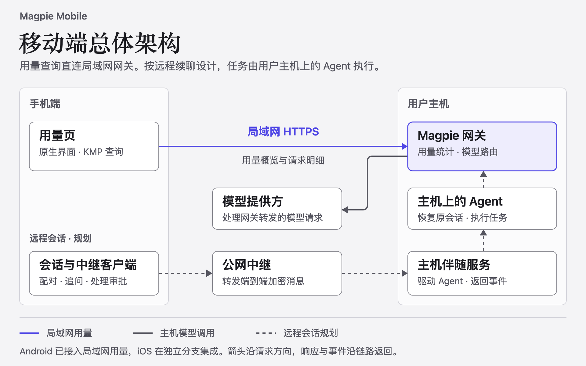
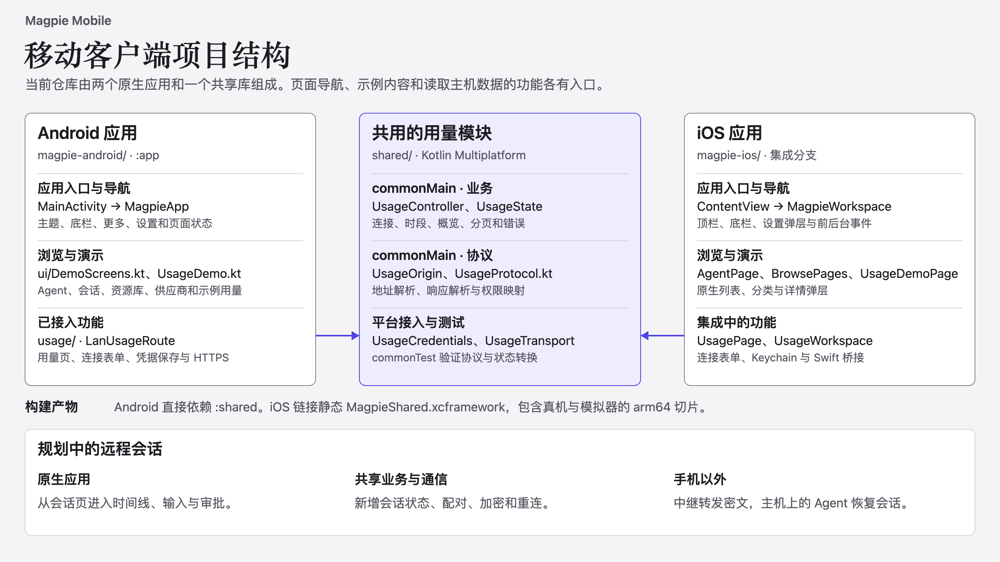
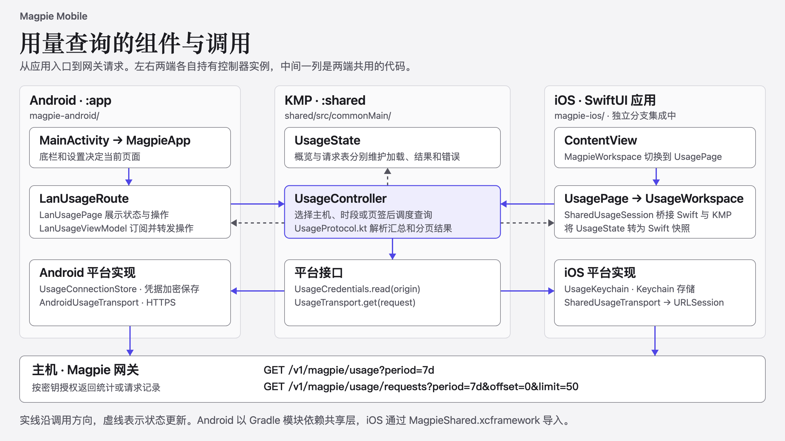
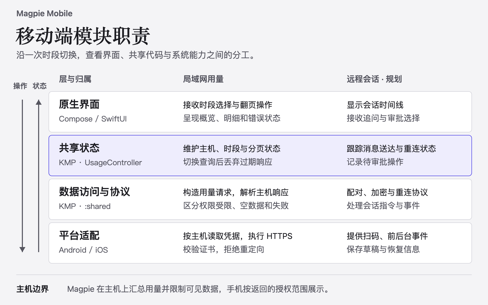

# Magpie Mobile 移动端架构

## 当前实现

Android 的 Compose 用量页已通过 Kotlin Multiplatform（KMP）共享模块读取 Magpie 网关。iOS 在独立开发分支中接入同一模块，使用 SwiftUI 呈现。公网中继、远程续聊和审批属于后续设计。[Android 模块配置](../magpie-android/settings.gradle.kts) · [共享模块及 Swift 接入说明](../shared/README.md)

[总体架构图源（HTML，内嵌 SVG）](diagrams/system-architecture.html)

## 客户端工程结构

Android 和 iOS 各自拥有导航、页面和系统生命周期。两个工程共享的是已接入主机的用量业务。浏览示例、选择外观、打开「更多」都在端内完成。页面如何排布、会话详情将来从哪里进入，见独立的[移动端 UI 设计](mobile-ui.md)。

[工程结构图源](diagrams/project-structure.html)

| 从仓库哪里开始 | 可以找到什么 |
| --- | --- |
| [Android 应用入口](../magpie-android/app/src/main/java/com/andychen/magpie_android/MainActivity.kt) · [导航和设置](../magpie-android/app/src/main/java/com/andychen/magpie_android/ui/MagpieApp.kt) | Activity 创建用量 ViewModel，向 Compose 应用传入用量入口。导航层选择普通浏览页或用量页，处理底栏、设置和返回。 |
| [Android 浏览示例](../magpie-android/app/src/main/java/com/andychen/magpie_android/ui/DemoScreens.kt) · [局域网用量](../magpie-android/app/src/main/java/com/andychen/magpie_android/usage/) | 示例页维护本地交互。局域网功能有独立的 Route、Page、ViewModel、连接存储和传输适配，演示用量由用户显式进入。 |
| [共享库构建](../shared/build.gradle.kts) · [共享源码](../shared/src/commonMain/kotlin/com/andychen/magpie/shared/usage/) · [共同用例](../shared/src/commonTest/kotlin/com/andychen/magpie/shared/usage/) | `commonMain` 定义查询状态、网关协议和平台接口。`commonTest` 用受控响应覆盖权限、分页和旧响应。Android 通过 Gradle 导入，Swift 通过静态 XCFramework 导入。 |
| [iOS 工程](../magpie-ios/magpie-ios.xcodeproj/) · [Swift 调用示例](../shared/examples/UsageBridgeSmoke.swift) | iOS 集成工作区以 `ContentView` 持有 `UsageWorkspace`，通过 `SharedUsageSession` 调用共享库。图中的这些 Swift 类型来自独立的 iOS 集成工作区，当前 Android 分支中可查看共享库的 Swift 调用样例。 |

## 用量功能怎样穿过两端工程

[组件调用图源](diagrams/client-internals.html)

以「最近 7 天 → 请求 → 加载更多」为例，可以从界面一路追到网关。

1. **接收操作。** Android 的 `LanUsageViewModel` 将时段和标签传给控制器，使用 `SavedStateHandle` 记住两项选择。iOS 集成中的 `UsageWorkspace` 把选择交给 `SharedUsageSession`，将共享观察结果转换为 Swift 的 `UsageSnapshot`。[Android ViewModel](../magpie-android/app/src/main/java/com/andychen/magpie_android/usage/LanUsageViewModel.kt)
2. **建立查询。** `UsageController` 在更换主机或时段时更新查询版本、取消原查询并加载当前标签。打开请求表从 `offset=0` 开始，每页 50 条。[控制器](../shared/src/commonMain/kotlin/com/andychen/magpie/shared/usage/UsageController.kt)
3. **读取主机数据。** Android 默认通过已配对 Mac 的加密会话读取用量，Mac 按设备检查用量授权并查询本机网关。选择手动 HTTPS 时，共享层按 origin 读取凭据，把带授权头的 GET 请求交给平台。Android 使用 `UsageConnectionStore` 和 `HttpsURLConnection`。iOS 通过 Keychain 保存和恢复连接，经 `URLSession` 发出同类请求。[Android 用量来源](usage/android.md) · [共享接口](../shared/src/commonMain/kotlin/com/andychen/magpie/shared/usage/UsageQuerySource.kt) · [Mac 授权与协议](../magpie-plugin/README.md#已配对设备的用量)
4. **显示结果。** 共享层分别更新 `SummaryState` 和 `RequestsState`。概览返回受限密钥错误时，用户仍可打开有权访问的请求表。下一页按服务端返回的 `offset + rows.size` 计算。翻页出错时保留先前的行和重试位置。[状态模型](../shared/src/commonMain/kotlin/com/andychen/magpie/shared/usage/UsageModels.kt) · [协议解析](../shared/src/commonMain/kotlin/com/andychen/magpie/shared/usage/UsageProtocol.kt)

## 从用量扩展到远程会话

远程会话会引入写操作、异步事件和送达确认。以下是拟议的职责边界，具体类型和工程模块仍待主机协议验证。主机系统以 macOS、Windows、Linux 为例，主机上运行的 Agent 可以是 Codex、Claude Code、Pi 等。恢复会话和处理审批的能力需按系统与 Agent 的组合验证。

| 用户动作 | 接入位置 | 需要主机提供的依据 |
| --- | --- | --- |
| 选择或配对主机 | 原生顶栏提供主机选择和扫码。共享连接逻辑识别主机，平台安全存储保存配对凭据。 | 主机身份、配对结果与可用能力。局域网用量密钥只用于已配置的网关。 |
| 打开原会话并追问 | 在现有「会话」入口增加详情和输入区。共享会话业务维护原会话标识、草稿归属、送达状态和事件顺序。 | 历史记录能否映射到对应 Agent 可恢复的原会话，以及操作是否已被执行。 |
| 重连或处理审批 | 共享通信层通过中继与主机伴随服务交换加密消息。原生页面消费状态，展示待确认消息或审批详情。 | 重放缺失事件、关联一次操作、判断审批是否仍有效。若模型调用配置为经 Magpie 路由，再由网关记录用量。 |

## 目标分工

[模块职责图源（HTML，内嵌 SVG）](diagrams/module-responsibilities.html)

| 职责 | 归属 | 以用户操作为例 |
| --- | --- | --- |
| 页面呈现与交互 | Compose、SwiftUI | 两端分别处理导航、系统返回、筛选菜单和详情弹层。选定时间范围后，把查询意图交给共享层。 |
| 应用状态与业务规则 | KMP | 管理当前主机、用量查询结果、会话可恢复性与消息送达状态。切换主机后到达的旧请求结果只属于原主机。 |
| 数据访问与通信 | KMP，通过平台接口使用系统能力 | 按目标版本调用 Magpie，解析响应并保留权限和错误含义。远程会话走主机服务及其通信协议。 |
| 平台能力 | Android、iOS 原生实现 | 提供扫码、安全保存凭据和前后台事件，把连接变化交给应用状态层处理。 |
| 主机与中继 | 用户主机执行，公网中继转发加密消息 | 在手机继续对话时，由主机上的 Agent 恢复原会话。手机据主机事件更新送达状态。 |

图中两层 KMP 职责都在 `:shared` 内。以切换时段为例，`UsageController` 更新查询并发布状态，平台通过 `UsageCredentials` 按主机提供密钥，通过 `UsageTransport` 执行请求。[查询控制器](../shared/src/commonMain/kotlin/com/andychen/magpie/shared/usage/UsageController.kt) · [平台接口](../shared/src/commonMain/kotlin/com/andychen/magpie/shared/usage/UsageTransport.kt)

## 用量查询的验收示例

首轮实现的范围、数据字段和双端交接以[局域网只读用量设计](usage/README.md)的确认版本为准。

用户在某台主机选择“最近 7 天”。客户端向这台主机请求 `period=7d`，按主机返回的汇总展示。请求明细支持分页，单页行数只代表该页。切换时间范围或主机后，只展示与当前查询匹配的结果。[上游时间范围](https://github.com/yetone/magpie/blob/426a707a19ff7f481989f03c49519bf4dba1e593/internal/usage/usage.go#L540) · [上游汇总与明细接口](https://github.com/yetone/magpie/blob/426a707a19ff7f481989f03c49519bf4dba1e593/internal/gateway/usage_api.go#L59)

| 给定条件 | 两端应能观察到的结果 |
| --- | --- |
| 主机成功返回汇总，当前范围内有记录或确实为零 | 显示主机给出的数值，零记录时显示空状态。 |
| 受限密钥读取汇总被拒，但允许读取自己的请求明细 | 概览说明权限范围。请求页仍可列出该密钥可见的记录。 |
| 手机断网，或旧主机的响应在切换后才到达 | 断网时显示连接问题与重试入口。旧响应不会覆盖当前主机的数据。 |

实现时用同一组脱敏响应验证两端的状态映射，再对照手机与主机在相同授权范围和时段下显示的真实结果。接口或状态含义改变时，同步更新对应示例和行为测试。页面布局、字体和导航体验在各平台独立验证。
