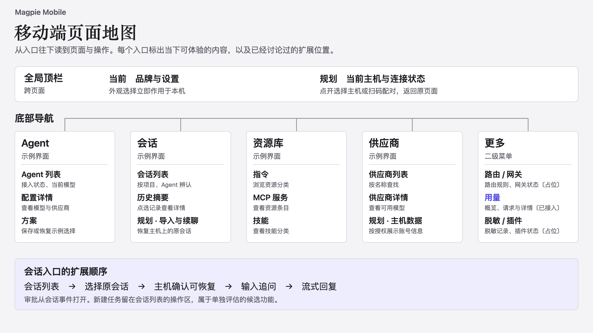
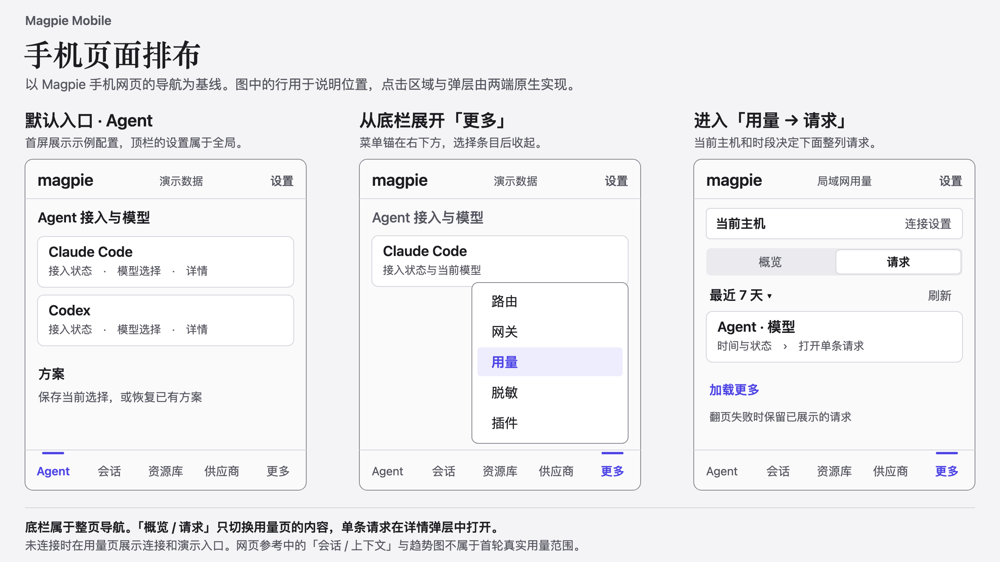
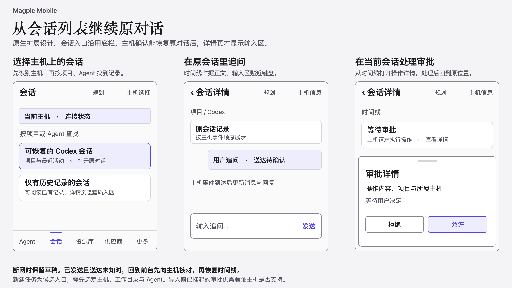

# 移动端 UI 设计

在手机上管理 Magpie 时，用户可以沿用网页上熟悉的入口。到了跨网续聊场景，用户还需要知道当前连着哪台主机、打开的是哪条原会话，以及刚才的追问是否送达。这份设计以同一套导航容纳两类操作，供 Android 和 iOS 后续扩展时对照。

## 导航与页面地图

[页面地图源文件](diagrams/mobile-navigation.html)

参考版本为 Magpie `426a707a1`。该版本的手机网页按可见页面数量计算底栏。超过五页时，前四页直接显示，其余进入「更多」。在参考的默认布局中，这四页是 Agent、会话、资源库、供应商。当前两个原生工程显式列出这组主入口和「更多」菜单项。新增页面时，需同时考虑它与既有入口的关系，以及主机实际提供的权限。[上游导航定义](https://github.com/yetone/magpie/blob/426a707a19ff7f481989f03c49519bf4dba1e593/internal/gui/assets/index.html#L73) · [上游手机底栏逻辑](https://github.com/yetone/magpie/blob/426a707a19ff7f481989f03c49519bf4dba1e593/internal/gui/assets/phonetabs.js#L17) · [Android 原生导航](../magpie-android/app/src/main/java/com/andychen/magpie_android/ui/MagpieApp.kt)

| 入口 | 当前原生界面与数据 | 可扩展的位置 |
| --- | --- | --- |
| 顶栏 · 设置 | 品牌、页面数据提示和设置入口。本机外观可切换。Android 使用设置页，iOS 使用弹层，关闭后回到原页面。 | 顶栏显示当前主机及连接状态，点开选择主机或扫码配对。将本机外观和影响主机的操作分组。 |
| Agent | 示例列表显示接入状态、当前模型、详情及方案。选择模型只改变示例。 | 在配置详情接入主机读取。若开放写操作，提交前明确影响当前会话、新会话还是主机默认值。 |
| 会话 | 当前展示示例会话，可查找记录并打开摘要。 | 在列表增加主机来源与可恢复状态，从同一记录打开历史或续聊详情。新建任务是列表级候选操作。 |
| 资源库 | 分类浏览指令、MCP 服务和技能。iOS 示例另有「记忆」分类。 | 从分类进入主机条目及详情，按主机能力和授权显示可读取的资源。 |
| 供应商 | 示例列表提供查找和详情，列出模型信息。 | 在详情增加主机授权可见的供应商、订阅账号和模型。涉及配置变更时单独确定管理权限。 |
| 更多 · 路由、网关 | 已有页面入口，目前展示占位或未连接状态。 | 路由页查看路由组、成员和回退记录，网关页查看主机网关状态。 |
| 更多 · 用量 | 局域网路径包含连接、概览、分页请求及单条详情。Android 已接入，iOS 在独立工作区集成。演示入口单独打开。 | 分组或趋势图可作为「概览」的下钻。新增指标时先确认主机能返回对应数据。 |
| 更多 · 脱敏、插件 | 已有页面入口，目前展示占位或未连接状态。 | 脱敏记录展开到一次请求的处理结果，插件列表展开到单个插件状态。 |

## 手机页面怎样排布

[页面排布图源文件](diagrams/mobile-ui-layout.html)

- **全局与页内导航。** 顶栏放产品标识、数据来源提示和设置。页面正文滚动，底栏保留一级入口。「更多」展开时覆盖当前内容，选择后进入对应页面并收起。用量页内的「概览 / 请求」只切换当前主机的查询内容。
- **连接与空状态。** 首次打开用量，正文给出连接主机和查看演示两个入口。连接表单收集 HTTPS 网关地址与密钥。连接成功后，页首先显示主机，再显示标签、时段和刷新入口。断开并清除连接后回到首次连接状态。
- **列表与详情。** 请求列表显示时间、Agent、模型及可用的状态信息。点一行打开单条详情，关闭后回到请求表。概览受限时展示原因并保留「请求」入口。翻页失败时将重试放在列表末尾，让用户仍能阅读已加载的记录。
- **网页与原生的差异。** 参考网页的用量页还有「会话」「上下文」、趋势图和分组统计。首轮真实用量只呈现概览和请求接口提供的数据。这里的顶层「会话」始终指主机会话浏览与计划中的续聊。

## 原生扩展设计 · 从历史记录到远程续聊

[会话扩展图源文件](diagrams/session-extension.html)

| 触发条件 | 页面与操作 | 返回或恢复 |
| --- | --- | --- |
| 只有历史记录 | 详情显示原会话记录和只读原因，隐藏输入区。 | 返回原主机的会话列表。 |
| 主机确认可恢复 | 从选中记录导入或恢复原会话。详情顶部保留主机和项目上下文，中间滚动时间线，底部输入并发送追问。进入输入模式后底部空间留给输入区与键盘。 | 以主机事件更新该消息的送达状态与流式回复。返回列表时仍能辨认同一条原会话。 |
| 断网、锁屏或发送后失去确认 | 未发送的文字保留为该主机、该会话的草稿。已发出的消息显示「送达待确认」。 | 回到前台先核对操作与缺失事件，再更新已有消息。能确认重试安全时恢复发送操作。 |
| 出现待审批事件 | 时间线内显示待审批项。点开详情可查看主机、项目、具体操作并选择允许或拒绝。 | 以主机确认更新原事件，关闭弹层后仍在原会话。导入前就已挂起的审批需单独验证。 |
| 新建任务（候选） | 拟从会话列表的操作区进入，先选主机、工作目录和 Agent，再填写首条任务。 | 主机确认新会话标识后进入对应详情。入口及开放范围待产品确认。 |

## 双端走查

1. **当前基线。** 从 Agent 打开「更多 → 用量 → 请求 → 单条详情」，再依次关闭详情和设置。核对当前主机、时段与标签。分别走查未连接、受限密钥及翻页失败状态。[用量验收用例](usage/acceptance.md)
2. **扩展原型。** 从同一主机各选一条只读记录和一条可恢复会话，检查是否出现相应输入区。对可恢复会话发送追问后模拟断网，恢复时能辨认原消息，并根据主机结果更新状态。
3. **主机联调。** 以 Mac 上的原会话核对手机发送的追问。审批通过和拒绝各走一遍，核对反馈属于同一主机、会话与操作。该项依赖远程会话和审批契约实现。[工程边界与待验证契约](architecture.md#从用量扩展到远程会话)
